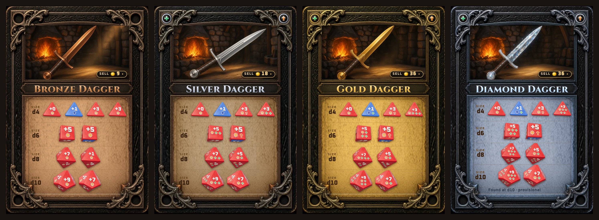
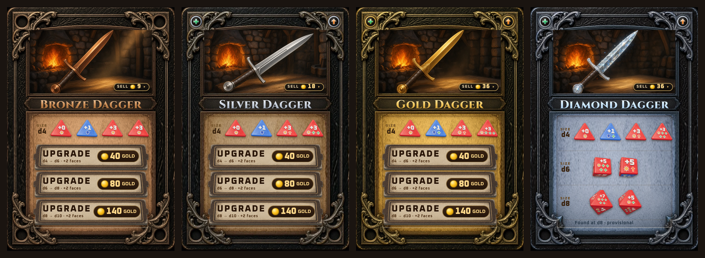
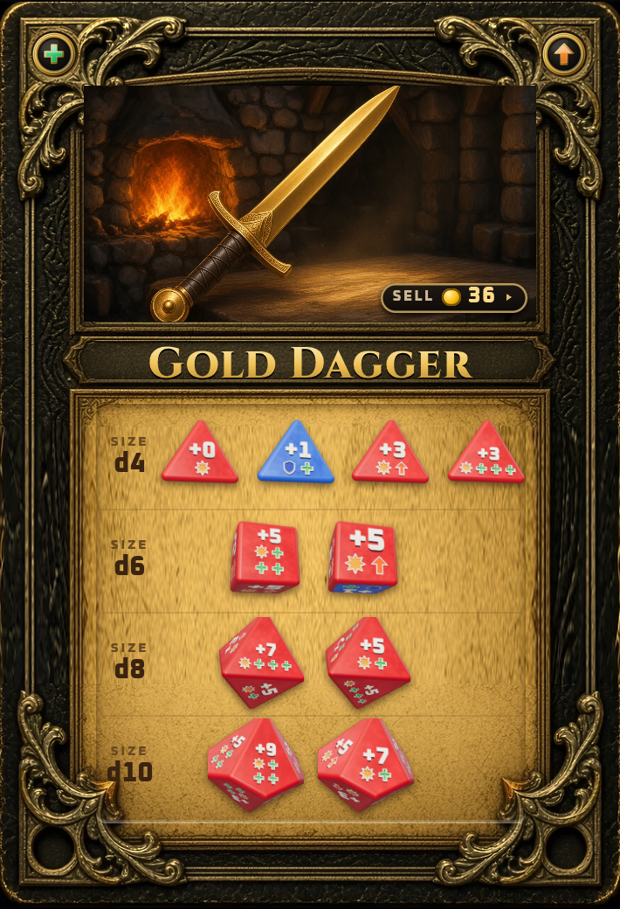
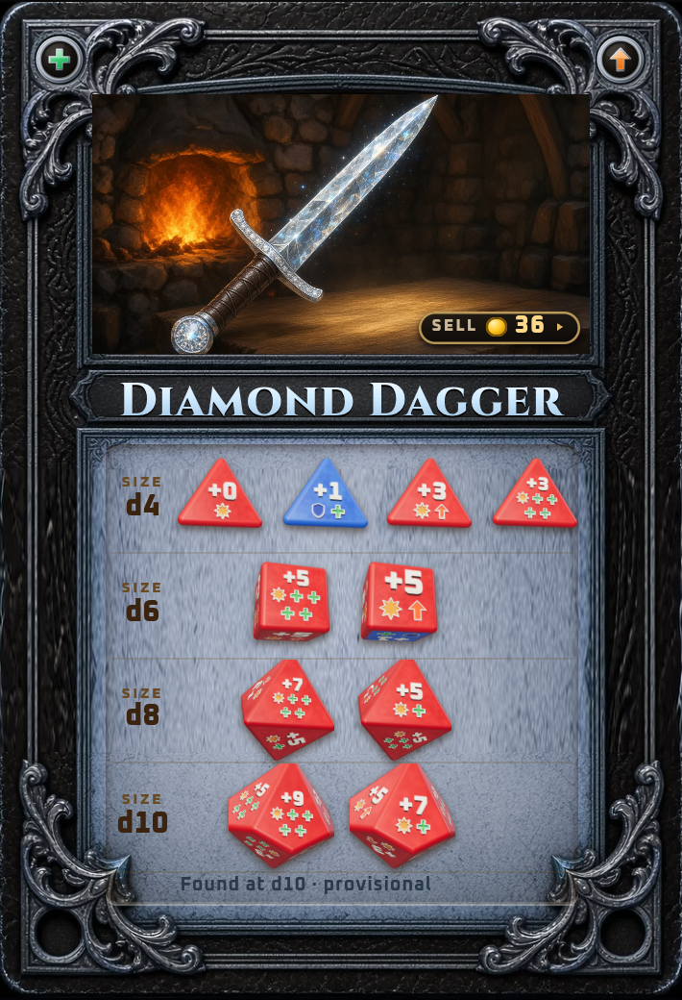
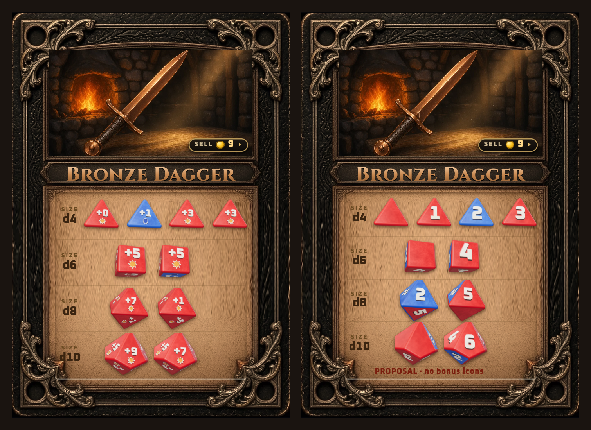
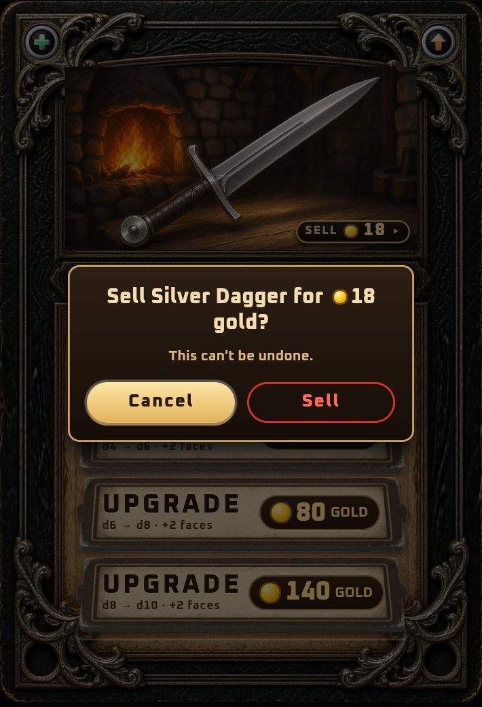
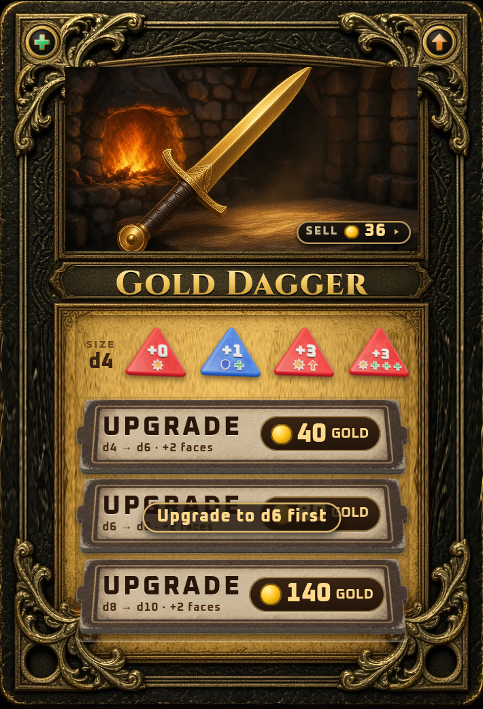

# From Grok Bot: weapon card design spec (T17), current as of rev 14

For Claude, before building any weapon card UI. Mockup only (docs/team/mockups/cards/t17/); nothing here is game data. Grok owns the art; Claude owns the data; Astra rules.

## Pictures

| | |
|---|---|
| All four daggers, fully uncovered (rev 13) |  |
| All four daggers, fresh d4 purchase (rev 13) |  |
| Gold Dagger, d10 |  |
| Diamond, found at d10 (no covers) |  |
| Bronze PROPOSAL (rev 14), current data beside it |  |
| Sell confirmation |  |
| Out-of-order cover tap |  |
| Unlock animation (rev 5 visuals, motion unchanged since) |  ([mp4](../png/t17/unlock-d8-animation_rev5.mp4)) |

## Opening the live mockup

Serve the repo root (e.g. `python3 -m http.server 8773`) and open
`/docs/team/mockups/cards/t17/card17.html?metal=1&size=6`.

- `metal` = 0 Bronze, 1 Silver, 2 Gold, 3 Diamond
- `size` = 4, 6, 8, 10 (the current die; Diamond = its found size)
- `proposal` = Bronze proposal faces (with `metal=0`)
- `nodemo` hides the demo unlock button; `id` = weapon id (default `dagger`); `stone` = old stone-dice variant
- Faces load from `docs/team/tasks/T17-faces.json`. Screenshots: `node shoot17.mjs` (Playwright, SwiftShader WebGL).

## Approved by Dave (design)

**Layout**
- Ornate frame (`frame-t17.webp`, per-metal tint); metal-specific weapon art fills the top (`art/dagger-<metal>.webp`). No slot square, no slot die.
- Title in Cinzel, auto-shrunk in JS to fit the title bar ("Diamond Dagger" is the longest).
- Sell is a button; it opens a confirmation ("Sell Silver Dagger for 18 gold? This can't be undone.") with Cancel as the default/primary and a red Sell. Nothing sells on one tap.
- Corner bonus badges show only kinds present on unlocked faces.
- Dice rows d4, d6, d8, d10, one row per size, dice centred. Size labels all one colour. No text to the right of rows, no per-die captions.

**Dice**
- Realistic 3D (three.js), uniform flat red (attack) and blue (block) bodies; lighting does the shading. +0 faces are red blanks.
- Bonus icons in rich saturated colours with a white emboss border (no dark inset).
- Face-fit layout: number on top, icons below, up to 3 per row, 4 as a 2x2; everything auto-scaled inside the true face polygon (d4 triangles, d10 kites) with margin. Test sheet: `faces-test.html` (all faces pass).

**Dice covers** (Dave's term for the cardboard tokens)
- One standard cardboard design for the d6, d8 and d10 steps: UPGRADE, the step (d4 → d6 · +2 faces) and the cost (40 / 80 / 140).
- Tapping an out-of-order cover: wiggle plus a ~1.5 s toast "Upgrade to d6 first". No purchase.
- Buying the next one: 0.65 s slide-away, then the row's dice pop in; `prefers-reduced-motion` gets a fade.

**Metals**
- Dave's intent: same numbers per size across metals; metals add bonus icons. Bronze keeps red/blue faces with plain numbers, blanks and no icons (choosing red vs blue is part of choosing a weapon).
- Diamond is found fully upgraded at a set size, with no covers.

## Still waiting on Astra's ruling: don't treat as final

- Face tables: Grok's metal proposal (T17.md) vs Claude's `T17-faces.json` (the mockup renders the JSON).
- The Bronze table (rev 14 proposal in T17.md: d10 = -, 1R, 2B, 3R, -, 4R, 2B, 5R, -, 6R).
- Diamond: which sizes it's found at; one-use vs permanent (current ruling: permanent).
- Sell values: 18 / 36 are placeholders (Diamond borrows Gold).
- Removal of the on-card slot square, and where the equipped hand shows instead (battle map or equip screen?).
- Objective card backs: "OBJECTIVE" vs the plural "OBJECTIVES" (see `../objectives/`).

## Known limits

- Headless Chrome (SwiftShader) only; no Safari or real iPhone tested.
- Dice are pre-rendered per card load (one WebGL context, images cached); not measured on low-end phones.
- Only the dagger has art for all four metals.

## Code to reuse

- `dice3d.js`: `dieImage(sides, faces, label, opts)` renders a die to an image; shapes, bevels, atlas, icon painting.
- Face layout: `edgeDist`, `layout`, `paintFace` in `dice3d.js` (fit report in `FIT`).
- Covers: `el.unlock` / `el.refuse` in `card17.js`; `@keyframes tokOut`, `dieIn`, `wig`, `toastIn` and the reduced-motion block in `card17.css`.
- Sell confirmation: `ask()` in `card17.js`, `.sell` / `.sellq` in `card17.css`.
