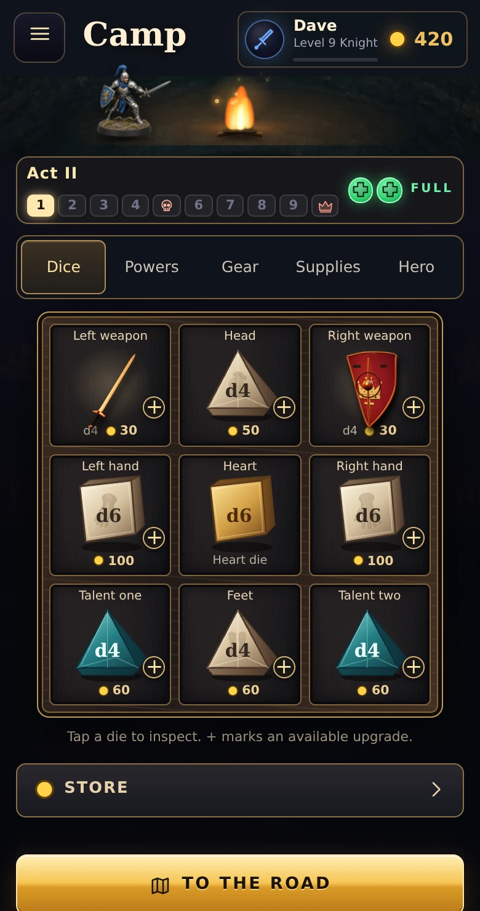
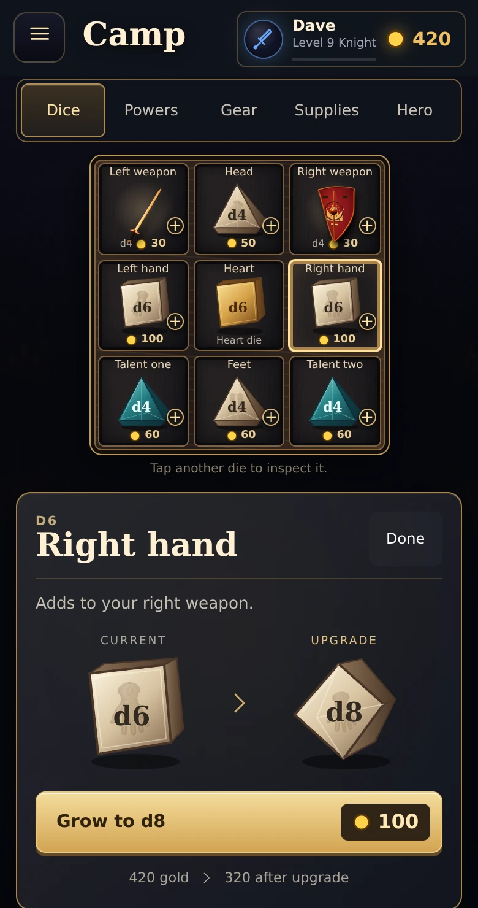

# Camp artwork pass: ready for visual review

Date: October 20, 2026. Base: 52f9d7d9f73e8dec7f7a1cbe3510eb178da184c1.
Branch: ui/camp-art-pass. This work has not been merged or deployed live.

## Changes

- Large shaded vector dice with real die sizes and existing body illustrations.
- Textured nine-tile board, weapon stills, affordable badges, and a clear selected slot.
- Inline inspection, current/next comparisons, price and remaining gold.
- Camp categories: Dice, Powers, Gear, Supplies, Hero. Shrinking is in Supplies; Store has its own entry.
- Existing engine commands, online adapter, inventory and save formats retained.

## Actual screenshots

Screenshots use disposable local test heroes. The starting Knight has 420 gold, a d6 right hand, and Act II access. The upgrade costs 100 gold and leaves 320.

| Camp board | Selected right hand |
| --- | --- |
|  |  |

[After purchase](../screens/camp-art/purchased.webp) / [Unaffordable](../screens/camp-art/unaffordable.webp) / [Short phone](../screens/camp-art/short-inspect.webp) / [Landscape](../screens/camp-art/landscape-inspect.webp).

## Validation

Before and after: npm test reports 318 passing / 2 failing out of 320. The same two local server tests failed before this work: two phones can sit, and a lock stays private on the wire; a hero takes their seat back from a new phone after the game has started. No test expectations or rules were changed.

The actual browser harness passed its purchase, exact gold, board refresh, local save/open round trip, focus restoration, five-category navigation, Store/return, unaffordable/max/locked states, weapon-control access, talent-editor access, reduced-motion and repeated-open checks. There were no browser page errors. It checked 390x740, 375x600, 393x852, 844x390 and 1280x800 layouts. Short views scroll to reach the complete inspector.

Reproduce with Playwright available in the development environment:

    CHROMIUM_PATH=/path/to/chromium node dev/camp-art-review.mjs

The script starts its own local server, uses isolated local test saves, blocks cloud service calls, and writes screenshots/results to ignored shots/.

## Performance scope

Net added gzip size for the changed runtime HTML, JS and CSS: 4,563 bytes, calculated by compressing each file independently against the base commit. This is an estimate of transfer overhead, not a measurement of the server's actual compression. No new runtime package, image asset, additional WebGL context, or camp animation loop. Existing body art and weapon portraits are reused. Documentation screenshots are not loaded by the game.

An earlier same-fixture local resource observation was 5,300,751 encoded same-origin bytes / 111 resources before, versus 5,316,570 / 113 during implementation. That limited observation excluded external resources and preceded final removal of obsolete CSS. It does not establish cold-load speed or real-phone frame rate.

## Remaining checks

Physical iPhone Safari, GPU smoothness, battery/heat, live cloud save, remote online-room behavior, complete party play, and a full campaign have not been verified. Existing online mutation routing is preserved, but that is not a substitute for a room test. The battle magic-powers triangle has not been redesigned.

Dave should review this first visual pass and try a camp purchase on his iPhone before a live merge.
