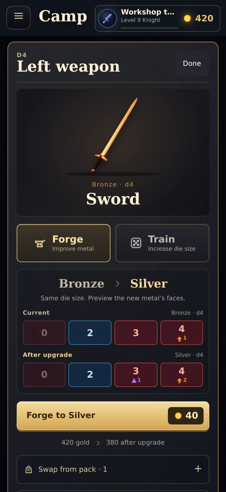
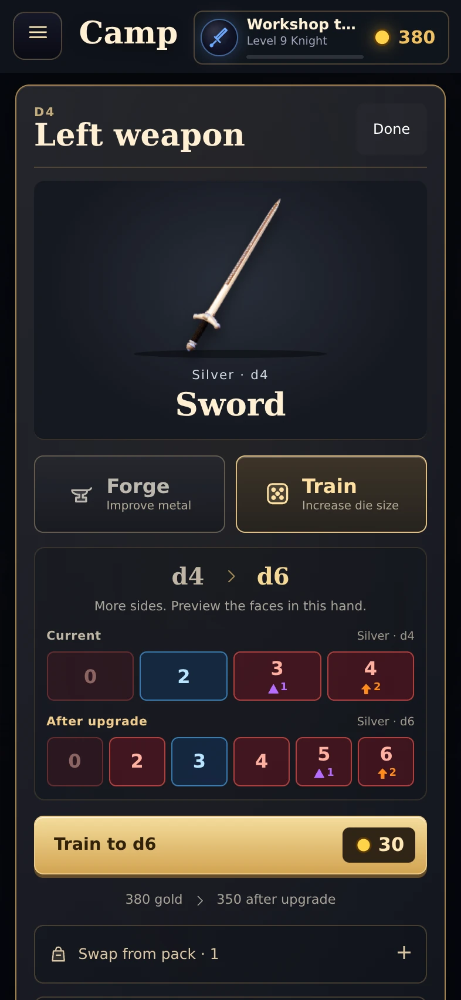

# Weapon workshop: section checkpoint

Date: October 20, 2026. Base: 344759280eea76f162feaba68e03b1445c9b90cb.
Branch: ui/camp-art-pass. Draft PR #30. This section has not been merged or deployed live.

## Completed section

Selecting an equipped weapon on the camp board opens a workshop with a large existing weapon portrait, metal, stored die size, and clear Forge / Train choices. Both choices show current and proposed faces from the battle engine, the exact existing purchase price, and remaining gold. Training explains any limit imposed by the selected hand. Pack swaps and the Diamond case remain accessible in expandable sections.

The selected right die of a two-handed weapon now targets its own UID. The engine already upgrades its two dice independently; the older inspector redirected both slots to the left UID. This is a UI target correction, with no changes to prices, face tables, equipment rules, saves, or online mutation authority. The earlier design document's linked-upgrade instruction was corrected to match the engine.

## Screenshots from the running game

| Forge | Train |
| --- | --- |
|  |  |

[After training](../screens/weapon-workshop/trained.webp), [hand requirement](../screens/weapon-workshop/locked.webp), [right die of a two-handed staff](../screens/weapon-workshop/two-handed.webp), [short phone](../screens/weapon-workshop/short.webp).

## Verification

The weapon browser review checks preview state immutability, authoritative target faces, exact Forge and Train charges, purchase refresh, local save/open, pack swap, Diamond Bring, unaffordable upgrades, hand requirements, asymmetric hand caps, independent two-handed dice, Legendary fixed metal, maximum sizes and empty hands. It checks 375x600, 390x740, 844x390 and 1280x800 layouts for horizontal overflow and browser page errors.

The earlier camp browser review also passes, including body upgrades, exact gold, saved state, focus restoration, categories, Store return and layout checks.

Reproduce with Playwright installed and a local Chromium binary:

    CHROMIUM_PATH=/path/to/chromium node dev/weapon-workshop-review.mjs
    CHROMIUM_PATH=/path/to/chromium node dev/camp-art-review.mjs

Both scripts use disposable local heroes and block cloud service requests. Review screenshots/results are written to ignored shots/.

The complete unit suite remains at 318 passing / 2 failing out of 320. The same two pre-existing failures are in test/server.test.mjs: private locks for two phones, and seat recovery from a new phone. Rules and test expectations were not changed.

## Size and limits

This section adds approximately 2,510 gzip bytes across changed runtime HTML, JS and CSS relative to the base above, compressing each file separately. This estimates transfer overhead, not actual server compression. No new runtime dependency, image asset, render loop, or WebGL context. Weapon stills are reused. Documentation screenshots are not loaded by the game.

Physical iPhone Safari, GPU smoothness, battery use, live cloud saves and online rooms still need device testing. Local browser verification does not establish those results.

## Resume here

Next bounded section: the talent die editor. Preserve its existing symbol, face and purchase rules; improve selection, preview and action hierarchy. Battle powers remain a later section. Keep work on this draft review branch until Dave approves publishing.
