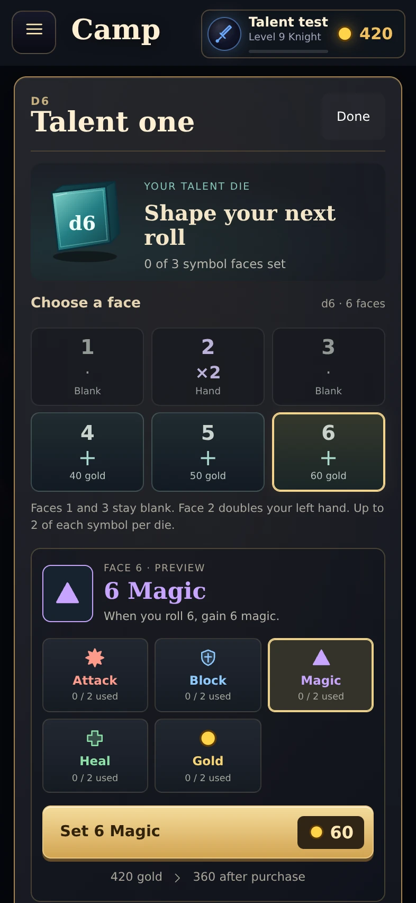
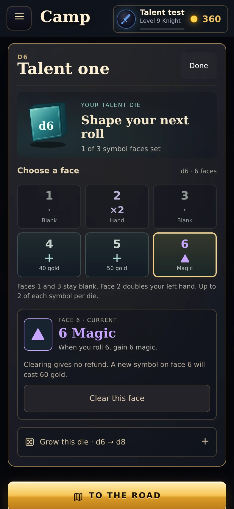

# Talent die editor: section checkpoint

Date: October 20, 2026. Base: 4759ac951f658e377d63ead11ae820383b8fabb0.
Branch: ui/camp-art-pass. Draft PR #30. Not merged or deployed live.

## Completed section

Selecting a talent die on the camp board opens a focused workbench. A small dimensional die and progress count introduce the complete face grid. Fixed blanks and the hand multiplier remain visible, with editable faces showing either their symbol or exact existing price.

Empty faces use a preview-first flow: choose a face, choose a symbol, then buy. The preview states what that face pays when rolled. Symbol choices show usage against the existing per-die limit. Choices spend no gold until the purchase button is pressed. The action shows the exact face price and remaining gold.

Filled faces now open an inspection panel rather than immediately removing their symbol. An explicit Clear action explains that clearing gives no refund and buying a replacement costs gold. Clearing still uses the existing engine command. Growing the die has its own expandable section, preserves existing symbols and uses the original act gates and prices.

No changes to engine rules, face costs, available symbols, the two-of-a-symbol limit, save formats or multiplayer mutation routing. The separate legacy talent-card and modal paths retain their existing appearance and behavior.

## Actual screenshots

| Preview before buying | Purchased face |
| --- | --- |
|  |  |

[Overview](../screens/talent-workshop/overview.webp), [symbol limit](../screens/talent-workshop/limit.webp), [not enough gold](../screens/talent-workshop/poor.webp), [short phone](../screens/talent-workshop/short.webp).

Screenshots use disposable local heroes. The featured d6 has empty faces 4, 5 and 6. Buying Magic on face 6 costs 60 gold, reducing 420 to 360. These are actual engine-derived values, not concept-image prices.

## Verification

The talent browser review passes:

- Choosing faces and previewing symbols leaves the complete hero state unchanged.
- Single selection and keyboard focus survive redraws.
- The explicit purchase sets only the chosen face, charges the exact price and updates the display.
- Symbol and gold survive local save/open.
- Inspecting a filled face leaves it intact; Clear removes it without a refund.
- Two copies disable that symbol on another face. Pierce is absent.
- Unaffordable symbols remain previewable with a disabled purchase and exact shortage.
- Growth charges the exact price, adds editable faces and preserves existing symbols.
- Act gates, maximum d10, right-die targeting and locked-die unlocking remain correct.
- 375x600, 393x852, 844x390 and 1280x800 layouts have no horizontal overflow; purchases are reachable by scrolling.
- Reduced motion, repeated selection and Done leave one editor and restore focus to the board.

No browser page errors. The earlier camp and weapon browser reviews also pass. The full unit suite remains 318 passing / 2 failing out of 320. Both failures are the previously observed server tests for private locks and recovering a seat on a new phone. No test expectations were changed.

Reproduce with Playwright installed and a local Chromium binary:

    CHROMIUM_PATH=/path/to/chromium node dev/talent-workshop-review.mjs
    CHROMIUM_PATH=/path/to/chromium node dev/camp-art-review.mjs
    CHROMIUM_PATH=/path/to/chromium node dev/weapon-workshop-review.mjs

Scripts use disposable local heroes, block cloud service calls, and write screenshots/results to ignored shots/.

## Size and limits

This section adds approximately 2,590 gzip bytes across runtime HTML, JS and CSS relative to the base above, compressing each file separately. This estimates transfer overhead, not actual server compression. No new runtime dependencies, image assets, render loops or WebGL contexts. The existing camp die art and symbol icons are reused. Documentation screenshots are not loaded by the game.

Physical iPhone Safari, real-phone smoothness/battery use, live cloud saving and online-room acceptance remain unverified. The adapter routing is preserved, but local tests do not establish live multiplayer behavior.

## Resume here

Completed checkpoints: camp/body dice, weapon workshop, talent die editor. Next bounded section: camp Powers organization and inspection. Retain the class library, power slots, learn/upgrade/equip rules and prices. Improve discovery, selected-power presentation and action clarity. Keep the battle magic-powers triangle as its own later section. Stay on the draft review branch until Dave approves publishing.
