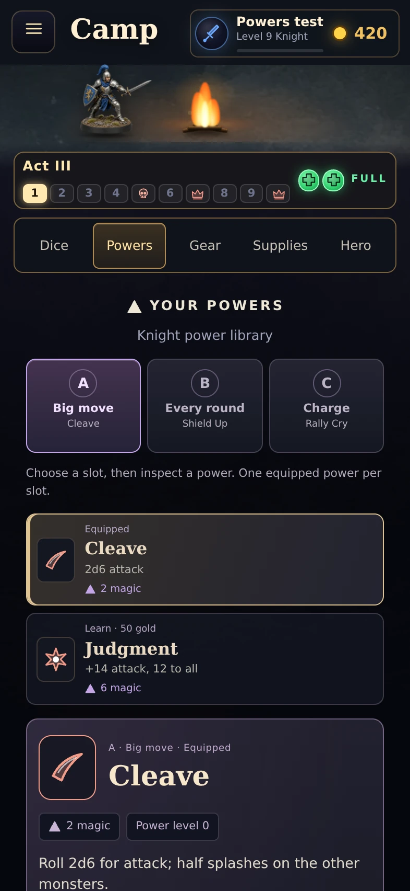
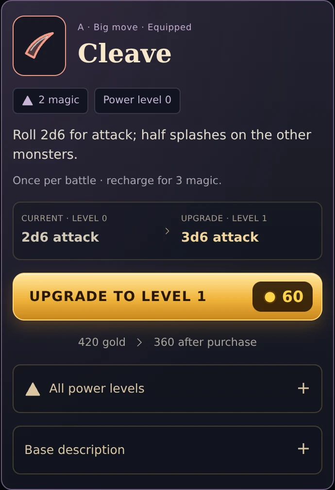

# Camp power library: section checkpoint

Date: October 20, 2026. Base: 51c3bfc0be9960aca40852e2630b8ac496b2407a.
Branch: ui/camp-art-pass. Draft PR #30. Not merged or deployed live.

## Completed section

The camp Powers category now opens a focused class library. Three slot choices show A / Big move, B / Every round and C / Charge, along with the power currently equipped in each. Selecting a slot exposes its alternatives, their status, a short effect summary and the magic cost used in battle.

Selecting a power only inspects it. Its detail panel reuses the battle glyph and effect-description helpers, shows the actual stored power level, timing and magic cost, and presents one relevant action:

- Equipped: compare current and next level, then buy the existing upgrade.
- Learned: equip in its slot for free, with the replaced power named.
- Unlearned: learn and equip at the existing price, with the automatic equip explained.
- Level-gated: inspect the effect and hero-level requirement, without a purchase.
- Maximum power level: completed state instead of an invalid upgrade.

Remaining gold is shown for purchases. All-level previews follow each class's cap. The original base description is expandable, so its original numbers do not compete with the current upgraded effect. Recharge and round requirements are included where applicable.

Obsolete camp power-row builders were removed. No engine, class data, costs, save formats or multiplayer command routing changed. The battle powers triangle is unchanged in this section.

## Actual screenshots

| Class library | Selected upgrade |
| --- | --- |
|  |  |

[Learning](../screens/camp-powers/learn.webp), [level requirement](../screens/camp-powers/locked.webp), [not enough gold](../screens/camp-powers/poor.webp), [short phone](../screens/camp-powers/short.webp).

These screenshots use disposable local heroes. The Knight's Cleave goes from 2d6 to 3d6 attack for 60 gold, leaving 360 of 420. Values come from the existing rules and battle description helpers.

## Verification

The power-library browser review passes read-only slot/power selection, single selection and keyboard focus, current/next comparison, exact upgrade charges, learn-and-equip behavior, free swaps retaining prior upgrades, local save/open, insufficient-gold and maximum states, hero-level gates, class-specific level previews, all five class libraries and all three slots. It checks 375x600, 393x852, 844x390 and 1280x800 layouts for document overflow and reachable actions. Reduced motion, repeated browsing and Dice/Powers navigation leave one library. No browser page errors.

The earlier camp browser review also passes. The unit suite remains 318 passing / 2 failing out of 320. These are the same pre-existing server tests for private locks and recovering a seat from another phone. No test expectations were changed.

Reproduce with Playwright available and a local Chromium binary:

    CHROMIUM_PATH=/path/to/chromium node dev/camp-powers-review.mjs
    CHROMIUM_PATH=/path/to/chromium node dev/camp-art-review.mjs

The scripts use disposable local heroes, block cloud service requests, and write screenshots/results to ignored shots/.

## Size and limits

Net added gzip bytes for this section's runtime HTML, JS and CSS: approximately 1,723 relative to the base above, compressing each file separately. Removing unused builders offsets part of the new library. This is a transfer estimate, not actual server compression. Existing battle glyphs, effect helpers and icons are reused. No new runtime module, package, image asset, render loop or WebGL context. Documentation screenshots are not loaded by the game.

Physical iPhone Safari, device smoothness/battery use, live cloud saving and online-room acceptance are still unverified. Local state/save checks do not establish live multiplayer behavior.

## Resume here

Completed sections: camp/body dice, weapon workshop, talent editor, camp power library. Next bounded section: the battle magic-powers triangle and selected casting details. Preserve existing cast, charge, recharge, target, magic-spend and timing rules. Work from the actual battle UI and its current helpers; improve organization and selection feedback. Keep work on the draft review branch until Dave approves publishing.
